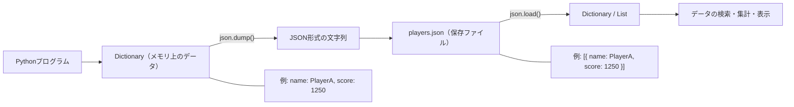

# 第04週 学習ドキュメント（学生向け）

## JSONの基礎（Web API設計の準備）

第03週で学んだFlaskでは、サーバーとクライアント（Unityなど）がデータをやり取りする際にJSONを使う。まずJSONの形式とPythonでの扱い方を学ぶ。

### 1. JSONとは
JSON（JavaScript Object Notation）は、データを文字列で表現するための軽量なテキスト形式。言語に依存せず、PythonでもC#（Unity）でも扱える。

JSONの例:

```json
{
  "name": "PlayerA",
  "level": 7,
  "hp": 85,
  "alive": true,
  "guild": null,
  "items": ["Potion", "Key"],
  "position": {"x": 10, "y": 20}
}
```

### 2. JSONの書式ルール
- 全体は`{ }`（オブジェクト）または`[ ]`（配列）で表す。
- キーは必ず**ダブルクォート`"`**で囲む（シングルクォートは不可）。
- 値の種類は、文字列、数値、真偽値（`true` / `false`）、`null`、配列、オブジェクトの6種類。
- 要素の区切りは`,`。**最後の要素の後ろにカンマを付けない**。
- コメントは書けない。

### 3. PythonとJSONの型の対応
| JSON | Python |
| ---- | ------ |
| オブジェクト `{}` | 辞書 `dict` |
| 配列 `[]` | リスト `list` |
| 文字列 | `str` |
| 数値 | `int` / `float` |
| `true` / `false` | `True` / `False` |
| `null` | `None` |

注意: タプルはJSONにないため、`json`で変換するとリスト（配列）になる。集合（`set`）は直接変換できない。

### 4. Pythonでの実装方法（標準ライブラリ`json`）
`json`は標準ライブラリのため、`pip install`は不要。

| 関数 | 役割 |
| ---- | ---- |
| `json.dumps()` | Pythonのデータ → JSON文字列 |
| `json.loads()` | JSON文字列 → Pythonのデータ |
| `json.dump()` | Pythonのデータ → JSONファイルへ書き込み |
| `json.load()` | JSONファイル → Pythonのデータ |

#### 4-1. 辞書をJSON文字列に変換（シリアライズ）

```python
# json_dumps_sample.py
import json

player = {
    "name": "PlayerA",
    "level": 7,
    "alive": True,
    "guild": None,
    "items": ["Potion", "Key"],
}

json_text = json.dumps(player, ensure_ascii=False, indent=2)

print(type(json_text))
print(json_text)
```

- `ensure_ascii=False`: 日本語をそのまま出力する。
- `indent=2`: 見やすく整形する。

#### 4-2. JSON文字列を辞書に変換（デシリアライズ）

```python
# json_loads_sample.py
import json

json_text = '{"name": "PlayerA", "level": 7, "items": ["Potion", "Key"]}'

player = json.loads(json_text)

print(type(player))
print(player["name"])
print(player["items"][0])
```

#### 4-3. ファイルへの保存と読み込み
ランキングデータをJSONファイルに保存し、読み込んで上位を表示する。

```python
# json_file_sample.py
import json

ranking = [
    {"name": "A", "score": 950},
    {"name": "B", "score": 1330},
    {"name": "C", "score": 1210},
]

with open("ranking.json", "w", encoding="utf-8") as f:
    json.dump(ranking, f, ensure_ascii=False, indent=2)

with open("ranking.json", "r", encoding="utf-8") as f:
    loaded = json.load(f)

best = max(loaded, key=lambda p: p["score"])
print("1位:", best["name"], best["score"])
```

#### 4-4. 不正なJSONのエラー処理
外部から受け取るデータは、形式が正しいとは限らない。

```python
# json_error_sample.py
import json

bad_text = "{'name': 'PlayerA'}"  # シングルクォートはJSONとして不正

try:
    data = json.loads(bad_text)
except json.JSONDecodeError as e:
    print("JSONの形式が不正です:", e)
```
#### 4-5. 理解度確認問題

##### 問題1（選択）
次のうち、正しいJSONはどれか。1つ選べ。

- A: `{'name': 'A', 'score': 100}`
- B: `{"name": "A", "score": 100,}`
- C: `{"name": "A", "score": 100}`
- D: `{name: "A", "score": 100}`

##### 問題2（対応）
次のJSONの値を、Pythonに変換したときの型で答えよ。

1. `"hello"`
2. `42`
3. `true`
4. `null`
5. `[1, 2, 3]`
6. `{"a": 1}`

##### 問題3（記述）
`json.dumps()`と`json.loads()`の違いを、それぞれの入力と出力に触れて説明せよ。

##### 問題4（読解）
次のコードを実行したとき、出力される内容を答えよ。

```python
import json

text = '{"name": "B", "items": ["Sword", "Shield"], "pos": {"x": 3, "y": 5}}'
data = json.loads(text)

print(data["items"][1])
print(data["pos"]["x"] + data["pos"]["y"])
```

##### 問題5（間違い探し）
次のJSON文字列には誤りが2か所ある。指摘して修正せよ。

```text
{
  'name': "PlayerC",
  "level": 5,
}
```

##### 問題6（プログラミング）
`json_practice.py`を作成し、次を実装せよ。

1. 3人分のプレイヤー（`name`, `score`, `items`のリスト）をリストと辞書で作成する。
2. `json.dumps()`でJSON文字列に変換し、`indent=2`で表示する。
3. 変換したJSON文字列を`json.loads()`で戻し、スコアが最も高いプレイヤーの名前を表示する。
4. `players.json`にファイル保存し、再度読み込んで合計スコアを表示する。

##### 問題7（発展）
次のタプルと集合を含む辞書を`json.dumps()`で変換するとどうなるか、実際に試して結果を報告せよ。エラーが出る場合は、変換できるようにコードを修正せよ。

```python
data = {"pos": (1, 2), "tags": {"a", "b"}}
```
##### 問題8（発展：HTMLレスポンス）
Flaskを使って、JSONではなくHTMLをレスポンスとして返すWebページを作成せよ。

1. `html_practice.py`を作成し、Flaskアプリケーションを定義する。
2. `/profile`にアクセスしたとき、プレイヤー情報をHTML形式で表示する。
3. 表示する情報は、名前・レベル・スコア・所持アイテムとする。
4. HTMLには`<h1>`、`<p>`、`<ul>`、`<li>`を使用する。
5. ブラウザで`http://127.0.0.1:5000/profile`を開き、HTMLとして表示されることを確認する。
6. 発展として、`/profile/<name>`のようにURLから名前を受け取り、見出しに表示せよ。

表示例:

```html
<h1>PlayerA のプロフィール</h1>
    <p>レベル: 7</p>
    <p>スコア: 1250</p>
    <h2>所持アイテム</h2>
    <ul>
        <li>Potion</li>
        <li>Key</li>
    </ul>
```

実装後、JSONレスポンスとHTMLレスポンスについて、「主な利用者」と「利用する場面」の違いを説明せよ。

### 5. データベースとしてDictionaryとJSONを使う

#### 5-1. DictionaryとJSONの使い分け
DictionaryはPythonの組み込みデータ構造であり、キーと値のペアを格納する。主にメモリ内でのデータ操作に使用される。
JSONは軽量なデータ交換形式であり、人間も機械も読み書きできる。ネットワーク通信やファイル保存に適している。
内部でデータベースを使う場合、データベースのテーブルやレコードの構造を辞書やリストで表現し、JSON形式で保存することが多い。



- Dictionaryは、Pythonプログラムの実行中にメモリ上で扱うデータである。
- `json.dump()`を使うと、DictionaryやListをJSON形式に変換してファイルへ保存できる。
- `json.load()`を使うと、JSONファイルの内容をPythonのDictionaryやListとして再び読み込める。

#### 5-2. CSVとの比較

CSV（Comma-Separated Values）は、表形式のデータをカンマで区切って保存する形式である。表計算ソフトで開きやすいため、名簿やランキングのように列が決まったデータの保存・確認に向いている。

| 観点 | JSON | CSV |
| ---- | ---- | --- |
| データ構造 | 辞書・リストの入れ子を表現できる | 行と列からなる表形式 |
| 向いているデータ | プレイヤー情報、アイテム一覧などの複雑なデータ | 名前・スコア・順位などの単純な一覧 |
| Pythonでの主なモジュール | `json` | `csv` |
| 表計算ソフトでの確認 | そのままでは確認しにくい | Excelなどで開きやすい |

たとえば、複数の所持アイテムを持つプレイヤーを保存する場合、JSONでは次のように表現できる。

```json
{
  "name": "PlayerA",
  "score": 1250,
  "items": ["Potion", "Key"]
}
```

CSVでは入れ子のリストを直接表現しにくいため、所持アイテムを1つの文字列にまとめるなどの工夫が必要になる。

```csv
name,score,items
PlayerA,1250,"Potion;Key"
```

JSONはWeb APIやゲームデータのように構造を持つデータに、CSVは表計算ソフトで確認・集計したい一覧データに適している。

#### 5-3. データベースとしての利用例

少量のデータであれば、JSONファイルを簡易的なデータベースとして利用できる。次の例では、`players.json`を読み込み、新しいプレイヤーを追加して保存し直す。

```python
# player_database.py
import json
from pathlib import Path

file_path = Path("players.json")

if file_path.exists():
    with file_path.open("r", encoding="utf-8") as f:
        players = json.load(f)
else:
    players = []

new_player = {
    "name": "PlayerD",
    "score": 880,
    "items": ["Potion"],
}

players.append(new_player)

with file_path.open("w", encoding="utf-8") as f:
    json.dump(players, f, ensure_ascii=False, indent=2)

print(f"{new_player['name']}を登録しました。登録人数: {len(players)}人")
```

このプログラムの処理の流れは次のとおりである。

1. `players.json`が存在するときは、`json.load()`でプレイヤー一覧を読み込む。
2. ファイルが存在しないときは、空のリストから開始する。
3. `append()`で新しいプレイヤーの辞書を一覧へ追加する。
4. `json.dump()`で一覧全体を`players.json`へ保存する。

JSONファイルは少人数のランキングや設定データの管理には便利である。一方で、複数の利用者が同時に更新するWebアプリケーションや大量のデータを扱う場合は、SQLiteやMySQLなどのデータベースを利用する。


##
次週以降とのつながり
- 第03週（Flask）: 辞書やリストを返すAPIを作成する。
- JSONを扱う回: 辞書をJSONとしてレスポンスで返し、Unity側が解釈しやすいデータ構造を設計する。
- 今回学んだ`dict`・`list`と`json.dumps` / `json.loads`が、そのままAPI開発の基礎になる。
