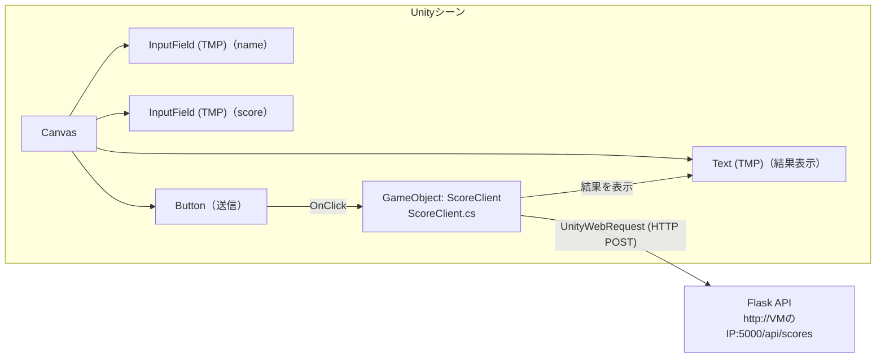
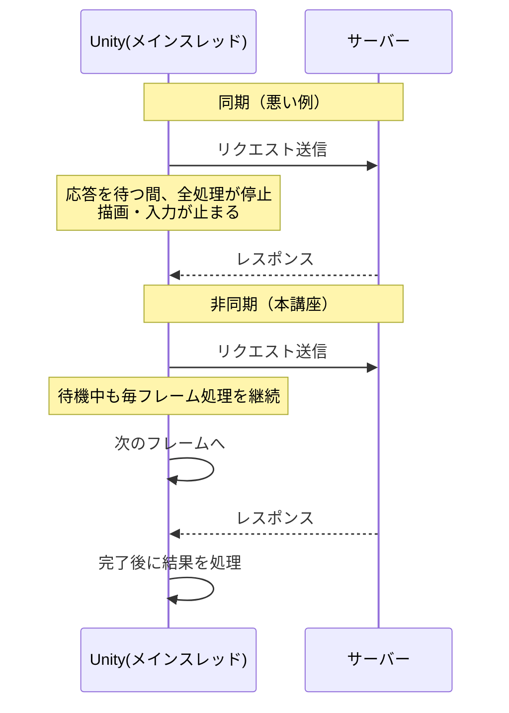
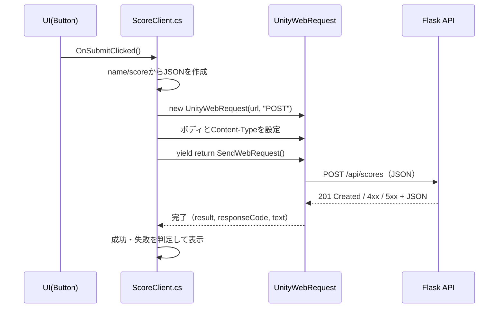
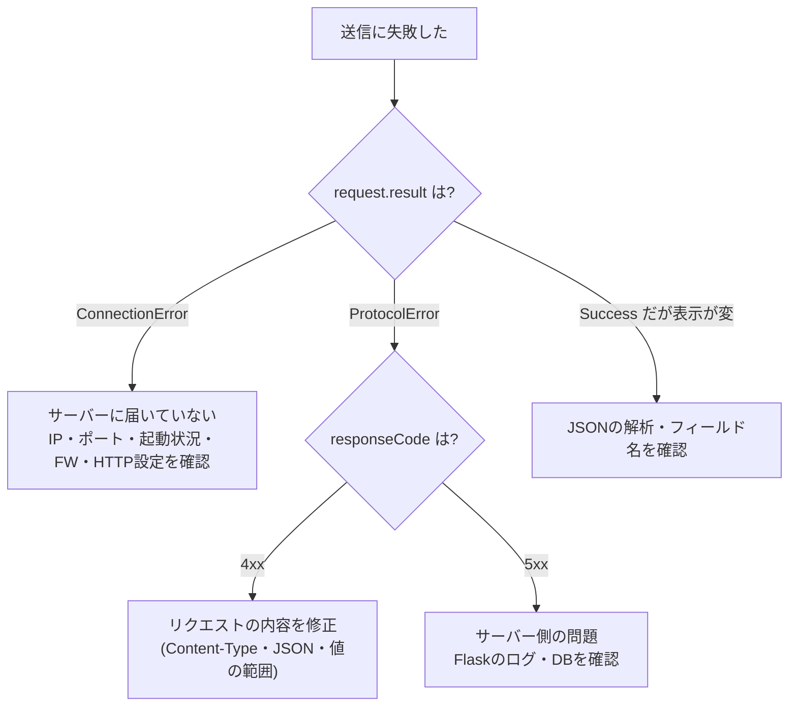

# 第07週 学習ドキュメント（学生向け）

## UnityからAPIへ非同期リクエストを送る（UnityWebRequest）

第06週で、スコアを受け取ってSQLiteへ保存するAPI（`POST /api/scores`）を作成した。今週はクライアント側であるUnityから、`UnityWebRequest`を使ってこのAPIへ非同期にリクエストを送り、レスポンスを処理するプログラムを作成する。

## 到達目標
- UnityからHTTPでサーバーへアクセスする一般的な方法と、必要な構成（Asset・コード・シーン）を説明できる。
- 通信を非同期で扱う必要性を説明し、コルーチンで実装できる。
- 第06週のAPIへスコアをPOSTし、成功・失敗の結果を画面に表示できる。
- 起こりうるエラーの原因を切り分け、対処できる。

### 第06週からの継続（開始手順）

サーバー（Ubuntu仮想マシン）側で、第06週のAPIを起動しておく。

```bash
cd ~/class_python/week06
source ../.venv/bin/activate
python3 app.py
```

起動時のログに表示される `Running on http://<VMのIPアドレス>:5000` を控えておく（例: `172.25.21.149`）。Unityから接続するアドレスにはこのIPアドレスを使う。

---

### 1. UnityからTCP/IPアクセスする一般的な方法

#### 1-1. 通信方法の位置づけ

HTTPは、TCP/IPの上で動作するプロトコルである。UnityからWeb APIへアクセスする場合、TCPのソケットを直接扱うのではなく、HTTPを扱える部品を使うのが一般的である。

| 方法 | 概要 | 位置づけ |
| ---- | ---- | ---- |
| `UnityWebRequest` | Unity標準のHTTPクライアント | **本講座で使用**。Asset追加不要で、Android/iOS/WebGLを含め広く使える |
| `System.Net.Http.HttpClient` | .NET標準のHTTPクライアント | PC向けでは使えるが、WebGLなど一部の環境で制限がある |
| `System.Net.Sockets.TcpClient` | TCPソケットの直接操作 | 独自プロトコルやリアルタイム通信向け。HTTP APIには過剰 |

第06週のAPIはHTTP（JSON）であるため、`UnityWebRequest`を使う。

#### 1-2. 最低限必要なもの

追加でインストールするAssetやパッケージは**不要**である。`UnityWebRequest`はUnityの標準機能に含まれる。

| 区分 | 必要なもの | 備考 |
| ---- | ---- | ---- |
| Asset | なし（標準機能） | JSONの変換には標準の`JsonUtility`を使う |
| スクリプト | `ScoreClient.cs`（通信処理） | シーン上のオブジェクトにアタッチする |
| シーン | 空のGameObject（通信担当）、UI（Button・InputField (TMP)・Text (TMP)） | 結果表示用のTextを用意する |
| パッケージ | TextMeshPro（`com.unity.textmeshpro`） | 通常は導入済み。初回に`TMP Essentials`のインポートが必要 |
| 設定 | HTTP通信の許可（後述） | 第06週のAPIは`http://`のため必要 |

#### 1-3. シーンのコンポーネント構成



構成手順:

1. 新しいシーンで、`GameObject` → `UI`から`Input Field - TextMeshPro`を2つ（name用、score用）、`Button - TextMeshPro`を1つ、`Text - TextMeshPro`を1つ配置する（`Canvas`は自動で作成される）。初回は`TMP Essentials`のインポートを求められるので、`Import TMP Essentials`を押す。
2. 空のGameObjectを作成し、`ScoreClient`と名付ける。
3. `ScoreClient`に、後述の`ScoreClient.cs`をアタッチする。
4. Inspectorで、`TMP_InputField`（2つ）、結果表示の`TMP_Text`、URLを設定する。
5. `Button`の`OnClick`に、`ScoreClient`の`OnSubmitClicked()`を登録する。

設定しないと日本語が□で表示される。

#### 1-4. エディタ拡張でUIを自動生成する（手順1〜5の代替）

手作業の代わりに、エディタ拡張スクリプトでシーンのUIを一括生成できる。メニューから実行するだけで、Canvas、EventSystem、入力欄2つ、ボタン、結果表示、`ScoreClient`の生成と、参照・`OnClick`の設定まで行う。

プロジェクト（`Server_unity/Unity/UnityClient`）に、次のファイルを配置している。

| ファイル | 内容 |
| ---- | ---- |
| `Assets/UnityClient/Week07/ScoreClient.cs` | 3-3のコード（通信処理） |
| `Assets/UnityClient/Week07/Editor/CreateScoreUi.cs` | UI生成のエディタ拡張 |
| `Assets/UnityClient/Week07/Editor/Week07Setup.cs` | HTTP許可と日本語フォントの設定 |

使い方:

1. Unityエディタで`Week07Client.unity`を開く。
2. スクリプトのコンパイル完了後、メニュー `Tools` → `Week07` → `Create Score UI` を実行する。
3. `ScoreClient`の`Url`を、VMのIPアドレスに合わせる。
4. 日本語を表示する場合は、TMPの日本語Font Assetを`ResultText`などに設定する。
5. シーンを保存（`Ctrl + S`）し、再生する。

解説:

- `Editor`フォルダ内のスクリプトは、エディタ専用でビルドには含まれない。
- `[MenuItem]`属性で、メニューに項目を追加している。
- `TMP_DefaultControls`で、メニューの`GameObject → UI`と同じ部品を生成している。
- `SerializedObject`で、private（`[SerializeField]`）のフィールドへ参照を設定している。
- `UnityEventTools.AddPersistentListener`で、ボタンの`OnClick`をInspectorと同じ形で登録している。
- Input Systemが導入されている場合、`EventSystem`には`InputSystemUIInputModule`を追加する。
- すでに`ScoreUiCanvas`がある場合は、二重生成を防ぐため実行を中止する。

##### 実行時に出やすい2つの問題とメニューでの対処

| 症状 | 原因 | 対処（メニュー） |
| ---- | ---- | ---- |
| `InvalidOperationException: Insecure connection not allowed` | Unity 6は既定で`http://`の通信を禁止している | `Tools` → `Week07` → `Allow HTTP (Insecure)`を実行する。反映されない場合はエディタを再起動する |
| 結果の日本語が`□`で表示される | TMPの既定フォントに日本語の字形が無い | `Tools` → `Week07` → `Setup Japanese Font`を実行する。OSの日本語フォントから動的Font Assetを作成し、既定フォントのフォールバックと、開いているシーンのTMPに設定する |

手動で行う場合:

- HTTP許可: `Edit` → `Project Settings` → `Player` → `Other Settings` → `Allow downloads over HTTP`を`Always allowed`にする。
- 日本語フォント: `Window` → `TextMeshPro` → `Font Asset Creator`でFont Assetを作成し、TMP_Textの`Font Asset`に設定する。

---

### 2. 通信を非同期で扱う必要性

#### 2-1. なぜ非同期が必要か

ネットワーク通信は、結果が返るまでに時間がかかる（数十ミリ秒〜数秒、場合によってはタイムアウトまで）。

Unityは、**メインスレッドが1フレームごとに処理（描画・入力・Update）を進める**。通信の完了までメインスレッドを止めて待つ（同期処理）と、その間はフレームが進まず、画面が固まる。



#### 2-2. Unityでの非同期の実装方法

| 方法 | 概要 | 位置づけ |
| ---- | ---- | ---- |
| コルーチン（`IEnumerator` + `yield return`） | フレームをまたいで処理を中断・再開する | **本講座で使用**。全バージョンで使える標準的な方法 |
| `async` / `await`（`Awaitable`など） | C#の非同期構文 | Unity 2023.1以降の`Awaitable`、またはUniTaskなどで利用可能 |

`UnityWebRequest`では、`SendWebRequest()`を`yield return`で待つ。待機中はコルーチンが中断し、Unityは次のフレームの処理を続ける。

---

### 3. 第06週のサーバーと通信する実装例

#### 3-1. 通信の仕様（第06週より）

| 項目 | 内容 |
| ---- | ---- |
| URL | `http://<VMのIPアドレス>:5000/api/scores` |
| メソッド | `POST` |
| `Content-Type` | `application/json` |
| リクエストボディ | `{"name": "PlayerA", "score": 1250}` |
| 成功時 | `201 Created` とJSON（`result`, `id`, `name`, `score`） |
| 失敗時 | `400`/`405`/`413`/`415`/`500` とJSON（`result`, `message`） |

#### 3-2. 全体の流れ



#### 3-3. コード: `ScoreClient.cs`

```csharp
// ScoreClient.cs
using System.Collections;
using System.Text;
using UnityEngine;
using UnityEngine.Networking;
using TMPro;

public class ScoreClient : MonoBehaviour
{
	[SerializeField] private string url = "http://172.25.21.149:5000/api/scores";
	[SerializeField] private TMP_InputField nameField;
	[SerializeField] private TMP_InputField scoreField;
	[SerializeField] private TMP_Text resultText;

	private bool isSending = false;

	[System.Serializable]
	private class ScoreRequest
	{
		public string name;
		public int score;
	}

	[System.Serializable]
	private class ScoreResponse
	{
		public string result;
		public int id;
		public string name;
		public int score;
		public string message;
	}

	// ボタンのOnClickから呼ぶ
	public void OnSubmitClicked()
	{
		if (isSending)
		{
			return;
		}

		if (!int.TryParse(scoreField.text, out int score))
		{
			resultText.text = "scoreは整数で入力してください。";
			return;
		}

		StartCoroutine(PostScore(nameField.text, score));
	}

	private IEnumerator PostScore(string playerName, int score)
	{
		isSending = true;
		resultText.text = "送信中...";

		string json = JsonUtility.ToJson(new ScoreRequest { name = playerName, score = score });
		byte[] body = Encoding.UTF8.GetBytes(json);

		using (UnityWebRequest request = new UnityWebRequest(url, UnityWebRequest.kHttpVerbPOST))
		{
			request.uploadHandler = new UploadHandlerRaw(body);
			request.downloadHandler = new DownloadHandlerBuffer();
			request.SetRequestHeader("Content-Type", "application/json");
			request.timeout = 10;

			yield return request.SendWebRequest();

			HandleResponse(request);
		}

		isSending = false;
	}

	private void HandleResponse(UnityWebRequest request)
	{
		// 通信自体の失敗（接続できない・タイムアウトなど）
		if (request.result == UnityWebRequest.Result.ConnectionError)
		{
			resultText.text = "サーバーに接続できません: " + request.error;
			return;
		}

		string responseText = request.downloadHandler.text;
		ScoreResponse response = JsonUtility.FromJson<ScoreResponse>(responseText);

		// HTTPエラー（4xx / 5xx）はProtocolErrorになる
		if (request.result == UnityWebRequest.Result.ProtocolError)
		{
			string message = response != null && !string.IsNullOrEmpty(response.message)
				? response.message
				: request.error;
			resultText.text = $"エラー({request.responseCode}): {message}";
			return;
		}

		if (request.result == UnityWebRequest.Result.Success)
		{
			resultText.text = $"登録成功: id={response.id}, name={response.name}, score={response.score}";
			return;
		}

		resultText.text = "予期しないエラー: " + request.error;
	}
}
```

#### 3-4. コードの解説

| 箇所 | 解説 |
| ---- | ---- |
| `[SerializeField]` | privateのままInspectorから値を設定できる。URL・UI部品を、コードを変えずに差し替えられる |
| `ScoreRequest` / `ScoreResponse` | JSONと対応するクラス。`JsonUtility`はクラスに`[Serializable]`が必要で、フィールド名がJSONのキー名と一致する必要がある |
| `JsonUtility.ToJson` | C#のオブジェクトをJSON文字列へ変換する（第04週の辞書→JSONに相当） |
| `Encoding.UTF8.GetBytes` | JSON文字列をUTF-8のバイト列にする。日本語名も正しく送れる |
| `new UnityWebRequest(url, "POST")` | メソッドを明示してリクエストを作成する |
| `UploadHandlerRaw(body)` | リクエストボディとして送るバイト列を指定する |
| `DownloadHandlerBuffer()` | レスポンスのボディを受け取る入れ物。無いと`downloadHandler.text`が読めない |
| `SetRequestHeader("Content-Type", ...)` | 第06週のAPIは`application/json`が必須。これが無いと`415`になる |
| `request.timeout = 10` | 10秒で応答が無い場合に失敗として扱う。無応答のまま待ち続けることを防ぐ |
| `yield return request.SendWebRequest()` | 送信し、完了までコルーチンを中断する。待機中もUnityは動き続ける |
| `using (...)` | 終了時に`Dispose`し、リソースを解放する |
| `isSending` | 二重送信を防ぐ。第06週で検討した多重POSTを、クライアント側でも抑える |
| `request.result` | 通信結果を判定する（次の表を参照） |

`request.result`の値:

| 値 | 意味 | 例 |
| ---- | ---- | ---- |
| `Success` | 通信とHTTPの両方が成功 | `201 Created` |
| `ConnectionError` | 通信そのものが失敗 | 接続できない、タイムアウト、名前解決の失敗 |
| `ProtocolError` | 通信はできたが、HTTPのエラー応答（4xx / 5xx） | `400`、`415`、`500` |
| `DataProcessingError` | データの処理に失敗 | レスポンスの解析に失敗 |

`ConnectionError`は「サーバーに届かなかった」、`ProtocolError`は「サーバーから4xx/5xxが返った」である。第06週で学んだとおり、4xxはリクエスト内容、5xxはサーバー側の問題である。ProtocolErrorでも`downloadHandler.text`にJSONが入っているため、`message`を取り出して画面に表示できる。

---

### 4. HTTP通信の許可設定

Unityは、既定で`http://`（非暗号化）の通信を禁止していることがある。この場合、第06週のAPI（`http://`）へアクセスすると、エラーになる。

学習用の設定:

1. メニューの `Edit` → `Project Settings` → `Player` を開く。
2. `Other Settings` の `Configuration` にある **`Allow downloads over HTTP`**（または`Insecure HTTP Option`）を `Always allowed` にする。
3. 設定後、Unityを再起動する場合がある。

> 学習用の設定である。公開するサービスでは`https://`（暗号化）を使い、HTTPを許可しない。

---

### 5. 動作確認の手順

1. Ubuntu仮想マシンで第06週のFlaskサーバーを起動する。
2. Windows側で、`curl.exe http://<VMのIPアドレス>:5000/api/scores` を実行し、`405`が返ることを確認する（到達できている）。
3. `ScoreClient`の`url`を、VMのIPアドレスに合わせる。
4. Unityの再生ボタンを押し、nameとscoreを入力して送信する。
5. 画面に「登録成功」と表示され、Flaskのログに `POST /api/scores ... 201` が出ることを確認する。
6. 範囲外の値や空のnameを送り、`400`の`message`が表示されることを確認する。

DBの内容は、VM上で次のとおり確認できる。

```bash
sqlite3 game.db "SELECT * FROM scores;"
```

> `UnityWebRequest`はブラウザではないため、第06週で扱った**CORSの制限は受けない**。

---

### 6. 起こりうるエラーと対処法

#### 6-1. エラーの切り分けの流れ



#### 6-2. エラー一覧

| 症状 | 想定される原因 | 対処法 |
| ---- | ---- | ---- |
| `Cannot connect to destination host` | サーバー未起動、IP・ポートの誤り、ファイアウォールでブロック | Flaskの起動確認、`ip a`でIP確認、`sudo ufw allow 5000/tcp`、Windowsで`curl.exe`による到達確認 |
| `127.0.0.1`を指定して接続できない | `127.0.0.1`はUnityを動かすPC自身を指す | VMのIPアドレスを指定する（第06週の8-5を参照） |
| `Insecure connection not allowed` | HTTP通信が禁止されている | 4章の`Allow downloads over HTTP`を有効にする |
| `Request timeout` | サーバーが応答しない、ネットワーク不通、VMのIP変更 | サーバーの起動確認、IPの再確認、`timeout`値の見直し |
| `415`（`Content-Typeはapplication/json...`） | `Content-Type`が未設定、または異なる | `SetRequestHeader("Content-Type", "application/json")`を設定する |
| `400`（JSONの形式が不正） | ボディが空、JSONが壊れている | `UploadHandlerRaw`の設定と、`ToJson`の結果を`Debug.Log`で確認する |
| `400`（必須・型・範囲のメッセージ） | name/scoreが仕様外 | クライアント側でも入力を確認し、サーバーの`message`を表示する |
| `405` | URLやメソッドの誤り | URLが`/api/scores`で、`POST`になっているか確認 |
| `413` | ボディが上限（10KB）を超える | 送信データを小さくする |
| `500` | サーバー内部の問題（DBの書き込みなど） | Flaskのログと`game.db`の状態を確認する |
| 画面が固まる | 通信を同期的に待っている | `yield return SendWebRequest()`によるコルーチンで実装する |
| `NullReferenceException` | InspectorでTMP_InputFieldやTMP_Textを未設定 |
| 二重に登録される | ボタンの連打 | `isSending`による制御を行う |
| 日本語のnameが文字化け | エンコーディングの不一致 | `Encoding.UTF8`でバイト列にし、`Content-Type`もJSONにする |

デバッグのコツ:

- `Debug.Log(json)`、`Debug.Log(request.responseCode)`、`Debug.Log(request.downloadHandler.text)`で、送受信の内容を確認する。
- 切り分けが難しい場合は、まず`curl`で同じJSONを送り、サーバー側が正しく動くか確認する。curlが成功してUnityが失敗するなら、Unity側（URL、ヘッダー、HTTP設定）を疑う。

---

### 7. GETとPOSTの使い分け（参考）

第06週ではPOST（登録）を作成した。取得（GET）では、`UnityWebRequest.Get(url)`を使う。ボディは不要である。ランキング取得は第09週で扱う。

```csharp
using (UnityWebRequest request = UnityWebRequest.Get(url))
{
	yield return request.SendWebRequest();
	// request.downloadHandler.text に結果が入る
}
```

| 観点 | GET | POST |
| ---- | ---- | ---- |
| 用途 | データの取得 | データの登録 |
| 作成方法 | `UnityWebRequest.Get(url)` | `new UnityWebRequest(url, "POST")` + `UploadHandlerRaw` |
| ボディ | なし | あり（JSONなど） |
| `Content-Type` | 不要 | JSONなら`application/json` |

---

### 8. 理解度確認問題

#### 問題1
UnityでHTTP通信を同期的に待つと、なぜ画面が固まるか説明せよ。

#### 問題2
`request.result`が`ConnectionError`の場合と`ProtocolError`の場合で、原因の切り分け方がどう違うか説明せよ。

#### 問題3
`UnityWebRequest`で`Content-Type`の設定を忘れると、第06週のAPIは何を返すか。ステータスコードとその理由を答えよ。

#### 問題4
UnityからVM上のFlaskに接続する際、`127.0.0.1`ではなくVMのIPアドレスを指定する理由を説明せよ。

#### 問題5
`UnityWebRequest`でCORSの設定が不要な理由を説明せよ。

#### 問題6（課題）
`ScoreClient`を拡張し、次の動作を実装せよ。

- name欄が空の場合は、送信せずに画面へエラーを表示する。
- 送信中は、ボタンを押せないようにする（`Button.interactable`を使う）。
- `ConnectionError`のとき、「サーバーの起動とIPアドレスを確認してください」と表示する。

#### 問題7（課題）
第06週のAPIに対して、あえて範囲外のscore（例: `-10`、`10000000`）を送り、`400`のメッセージが画面に表示されることを確認せよ。また、Flaskのログに残る内容も確認し、結果を報告せよ。

---

### 次週予告
第08週では、DBとの連携を拡張する。第09週では、ランキング取得APIを作り、`UnityWebRequest.Get`でUnityに表示する。
