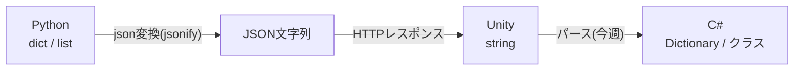
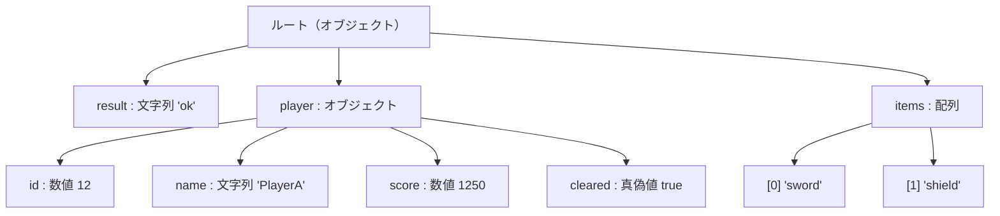
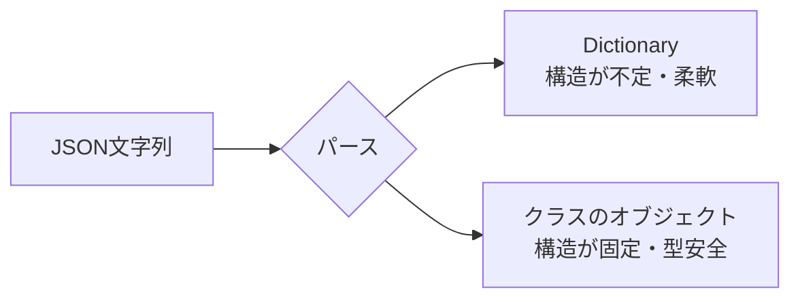
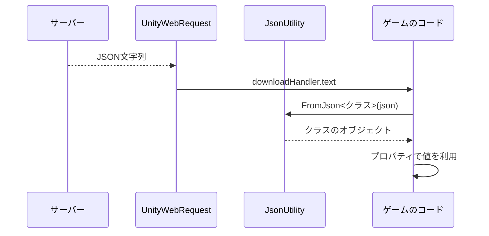
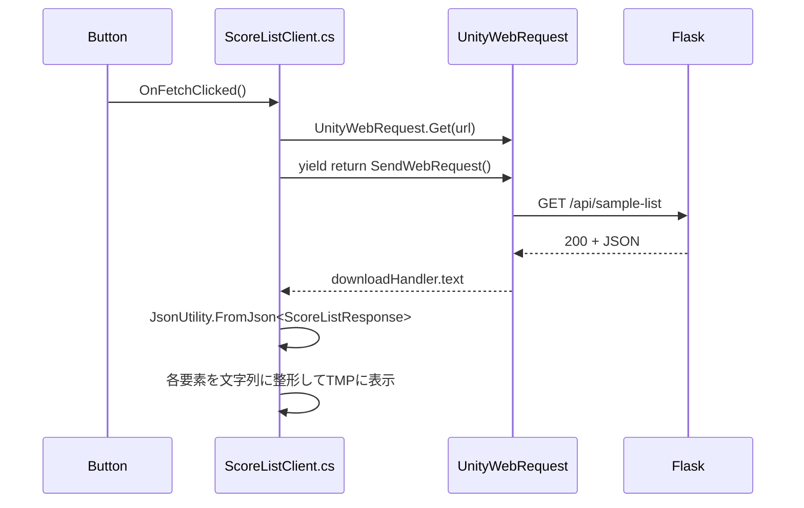

# 第08週 学習ドキュメント（学生向け）

## サーバーから返るJSONを受け取り、C#のデータとして扱う（JSONパース）

第07週で、UnityからAPIへリクエストを送り、レスポンスの文字列を受け取るところまで作成した。今週は、受け取ったJSON文字列を**パース（解析）**して、C#のDictionaryやクラスのオブジェクトに変換（デシリアライズ）し、ゲーム内で利用できるデータとして扱う。

## 到達目標
- JSON文字列の構造（オブジェクト、配列、値の型）を説明できる。
- パース（解析）とデシリアライズの概念を説明できる。
- JSON文字列をDictionaryへ変換し、値を取り出せる。
- JSON文字列をC#のクラスへ変換できる（`JsonUtility`）。
- `JsonUtility`の制約と、その対処方法を説明できる。

### 第07週からの継続（開始手順）

第06週のFlaskサーバーを起動しておく。

```bash
cd ~/class_python/week06
source ../.venv/bin/activate
python3 app.py
```

Unityは、第07週のプロジェクト（`Server_unity/Unity/UnityClient`）を使う。本章のコードは、特に断りがない限り**Unityエディタ（C#）**で実行する。

---

### 1. JSON文字列の構造の再確認

#### 1-1. JSONとは

JSON（JavaScript Object Notation）は、データを**文字列**で表現する形式である。サーバーとUnityは別のプログラム（Python と C#）であるため、メモリ上のオブジェクトを直接渡せない。そのため、いったん文字列にして送受信する。



#### 1-2. JSONで使える値の型

| JSONの型 | 例 | C#での対応 | Pythonでの対応 |
| ---- | ---- | ---- | ---- |
| オブジェクト | `{"name": "A"}` | クラス / `Dictionary<string, object>` | `dict` |
| 配列 | `[1, 2, 3]` | `List<T>` / 配列 | `list` |
| 文字列 | `"PlayerA"` | `string` | `str` |
| 数値 | `1250`、`3.14` | `int` / `long` / `float` / `double` | `int` / `float` |
| 真偽値 | `true`、`false` | `bool` | `True` / `False` |
| null | `null` | `null` | `None` |

#### 1-3. 文法の約束

- 文字列と、オブジェクトのキーは、必ず**ダブルクォート `"`**で囲む（シングルクォートは不可）。
- 最後の要素の後ろに**カンマを付けない**。
- コメントは書けない。
- 値は、オブジェクト・配列・文字列・数値・真偽値・nullのいずれかである。

#### 1-4. 構造の例（第06週のレスポンスを拡張）

```json
{
  "result": "ok",
  "player": {
	"id": 12,
	"name": "PlayerA",
	"score": 1250,
	"cleared": true
  },
  "items": ["sword", "shield"]
}
```

構造を図にすると、次のようになる。



---

### 2. パースの概念

#### 2-1. パース（解析）とは

**パース**とは、文字列を先頭から読み取り、文法に従って意味のある構造（木構造のデータ）に分解することである。JSONのパースでは、`{`や`"`、`:`といった記号から、キーと値の組、配列の要素を判別する。

| 用語 | 意味 |
| ---- | ---- |
| パース（parse） | 文字列を解析して、構造を取り出す |
| シリアライズ（serialize） | オブジェクト → 文字列（第07週の`JsonUtility.ToJson`） |
| デシリアライズ（deserialize） | 文字列 → オブジェクト（今週の`FromJson`） |

#### 2-2. 文字列のままでは使いにくい理由

受信した文字列は、ただの`string`である。

```csharp
string json = "{\"name\":\"PlayerA\",\"score\":1250}";
// json.Substring(...) などで文字を切り出すのは、
// 順序・空白・ネストの変化に弱く、バグの原因になる
```

パースして構造化することで、`player.score`のように**名前で安全に取り出せる**。

#### 2-3. パース後のデータの持ち方



| 方法 | 長所 | 短所 | 使う場面 |
| ---- | ---- | ---- | ---- |
| Dictionary | 構造が事前に分からなくても読める | 型が`object`で、キャスト・存在確認が必要 | 構造が変わる、デバッグ、一部の値のみ参照 |
| クラス | 型安全。補完が効き、ミスに気づきやすい | 構造に合わせたクラス定義が必要 | **ゲームのデータ処理の基本**（推奨） |

---

### 3. 準備: ライブラリの選択と、サーバー側の補足

#### 3-1. UnityのJSONライブラリ

| ライブラリ | Dictionary | クラス | 配列・ネスト | 備考 |
| ---- | ---- | ---- | ---- | ---- |
| `JsonUtility`（Unity標準） | **不可** | 可 | 制約あり（3-2参照） | 追加導入なし。軽量 |
| `Newtonsoft.Json`（Json.NET） | 可 | 可 | 柔軟 | UnityのパッケージManagerから導入できる |

`JsonUtility`はDictionaryへ変換**できない**ため、Dictionaryを学ぶ節では`Newtonsoft.Json`を使う。

#### 3-2. `JsonUtility`の主な制約

| 制約 | 内容 | 対処 |
| ---- | ---- | ---- |
| `Dictionary`は不可 | `Dictionary`フィールドは変換されない | `Newtonsoft.Json`を使う |
| 先頭が配列のJSONは不可 | `[{"a":1}]`を直接変換できない | ラッパーのクラスで包む（5-4） |
| 対象は`[Serializable]`クラス | 属性がないクラスは変換されない | クラスに`[System.Serializable]`を付ける |
| フィールド名が一致する必要がある | キー名とフィールド名が異なると、値が入らない | クラスのフィールド名をJSONのキーに合わせる |
| プロパティは対象外 | `{ get; set; }`は変換されない | **public（または`[SerializeField]`）のフィールド**にする |
| `null`の扱い | 欠落した項目は既定値（0、null、空）になる | 値の有無は別途確認する |
| エラーの通知が弱い | 不正なJSONで例外になることがある | `try-catch`で囲む |

#### 3-3. `Newtonsoft.Json`の導入手順

Unityのパッケージとして提供されている。

1. メニュー `Window` → `Package Manager` を開く。
2. 左上の `+` → `Install package by name...` を選ぶ。
3. 名前に `com.unity.nuget.newtonsoft-json` を入力して `Install` を押す。

または、`Packages/manifest.json`の`dependencies`に次を追加する。

```json
"com.unity.nuget.newtonsoft-json": "3.2.1",
```

導入後、スクリプトで`using Newtonsoft.Json;`が使える。

#### 3-4. 補足: 練習用のJSONを返すサーバーAPI

第06週のサーバーには、JSONを返す**GET**のAPIがまだない（`POST /api/scores`のみ）。ランキング取得（第09週）の前に、パースの練習用として、固定のJSONを返すAPIを追加する。

`app.py`に、次のコードを追加する（`if __name__ == "__main__":`の前）。

```python
@app.route("/api/sample", methods=["GET"])
def sample():
	return jsonify({
		"result": "ok",
		"player": {"id": 12, "name": "PlayerA", "score": 1250, "cleared": True},
		"items": ["sword", "shield"],
	})


@app.route("/api/sample-list", methods=["GET"])
def sample_list():
	return jsonify({
		"result": "ok",
		"scores": [
			{"id": 1, "name": "PlayerA", "score": 1250},
			{"id": 2, "name": "PlayerB", "score": 980},
			{"id": 3, "name": "プレイヤーC", "score": 700},
		],
	})
```

追加後、Flaskを再起動し、動作を確認する。

```bash
curl http://127.0.0.1:5000/api/sample
curl http://127.0.0.1:5000/api/sample-list
```

> 練習用の固定データを返すだけで、DBは使わない。ランキングAPIは第09週で作成する。
> サーバーを使わず、C#のコード内のJSON文字列だけでも、本章の練習は可能である。

---

### 4. Dictionaryへの変換

#### 4-1. 変換の方法（`Newtonsoft.Json`）

以降のコードは、Unityで実行できるよう`MonoBehaviour`のスクリプトとして示す。任意のGameObjectにアタッチして再生すると、`Start()`が実行され、結果が`Console`に表示される。

```csharp
// DictionaryFromJson.cs
using System.Collections.Generic;
using Newtonsoft.Json;
using UnityEngine;

public class DictionaryFromJson : MonoBehaviour
{
	private void Start()
	{
		string json = "{\"name\":\"PlayerA\",\"score\":1250,\"cleared\":true}";

		Dictionary<string, object> dict =
			JsonConvert.DeserializeObject<Dictionary<string, object>>(json);

		string name = (string)dict["name"];
		long score = (long)dict["score"];   // 整数は long になる
		bool cleared = (bool)dict["cleared"];

		Debug.Log($"name={name}, score={score}, cleared={cleared}");
	}
}
```

実行手順:

1. `Assets/UnityClient/Week08/`に、上記を`DictionaryFromJson.cs`として保存する（ファイル名とクラス名を一致させる）。
2. シーンに空のGameObjectを作成し、スクリプトをアタッチする。
3. 再生し、`Console`に`name=PlayerA, score=1250, cleared=True`と表示されることを確認する。

C#の型の対応は、次のとおりである（`object`に入る実際の型）。

| JSON | `object`の実際の型 |
| ---- | ---- |
| 文字列 | `string` |
| 整数 | `long`（`int`ではない） |
| 小数 | `double` |
| 真偽値 | `bool` |
| null | `null` |
| ネストしたオブジェクト | `JObject` |
| 配列 | `JArray` |

整数が`long`になる点は、キャストの失敗（`InvalidCastException`）の原因になりやすい。`Convert.ToInt32(dict["score"])`を使うと、型の違いを吸収できる。

#### 4-2. 存在確認と安全な取り出し

キーがない場合、`dict["key"]`は`KeyNotFoundException`になる。`TryGetValue`で確認する。

```csharp
// DictionaryTryGetValue.cs
using System.Collections.Generic;
using Newtonsoft.Json;
using UnityEngine;

public class DictionaryTryGetValue : MonoBehaviour
{
	private void Start()
	{
		// scoreのキーが無いJSON
		string json = "{\"name\":\"PlayerA\"}";
		var dict = JsonConvert.DeserializeObject<Dictionary<string, object>>(json);

		if (dict.TryGetValue("score", out object value))
		{
			int score = System.Convert.ToInt32(value);
			Debug.Log("score=" + score);
		}
		else
		{
			Debug.LogWarning("scoreがありません");
		}
	}
}
```

`"score"`を含むJSONに変えると、`score=...`が表示される。`dict["score"]`で直接参照した場合は、キーが無いと`KeyNotFoundException`になる点も試すとよい。

#### 4-3. ネストの扱い

```csharp
// DictionaryFromJsonNested.cs
using System.Collections.Generic;
using Newtonsoft.Json;
using Newtonsoft.Json.Linq;
using UnityEngine;

public class DictionaryFromJsonNested : MonoBehaviour
{
	private void Start()
	{
		string json = "{\"result\":\"ok\",\"player\":{\"name\":\"PlayerA\",\"score\":1250}}";
		var dict = JsonConvert.DeserializeObject<Dictionary<string, object>>(json);

		// playerは JObject になる
		var player = (JObject)dict["player"];
		string name = (string)player["name"];
		int score = (int)player["score"];

		Debug.Log($"player: name={name}, score={score}");
	}
}
```

JObjectを使わず、**入れ子まで`Dictionary`にしたい**場合は、変換先を`Dictionary<string, Dictionary<string, object>>`にするなど、型を指定する。構造がはっきりしている場合は、クラスに変換する方（5章）が扱いやすい。

#### 4-4. 実装例: Dictionaryの内容を表示する

```csharp
// DictionaryParseSample.cs
using System.Collections.Generic;
using Newtonsoft.Json;
using UnityEngine;

public class DictionaryParseSample : MonoBehaviour
{
	private void Start()
	{
		string json = "{\"result\":\"ok\",\"id\":12,\"name\":\"PlayerA\",\"score\":1250}";

		Dictionary<string, object> dict;
		try
		{
			dict = JsonConvert.DeserializeObject<Dictionary<string, object>>(json);
		}
		catch (JsonException e)
		{
			Debug.LogError("JSONの形式が不正です: " + e.Message);
			return;
		}

		foreach (KeyValuePair<string, object> pair in dict)
		{
			Debug.Log($"{pair.Key} = {pair.Value} ({pair.Value?.GetType().Name})");
		}
	}
}
```

実行結果（Consoleの表示）の例:

```text
result = ok (String)
id = 12 (Int64)
name = PlayerA (String)
score = 1250 (Int64)
```

> 第02週で学んだPythonの辞書（`dict["name"]`）と、考え方は同じである。ただしC#では型の指定が必要になる。

---

### 5. クラスへのデシリアライズ

#### 5-1. 基本の流れ



#### 5-2. クラスの定義のルール

JSONの構造に合わせて、クラスを定義する。

| JSON | クラス |
| ---- | ---- |
| オブジェクト | `[System.Serializable]`を付けたクラス |
| キー | クラスの**同名の**publicフィールド |
| 文字列 | `string` |
| 整数 | `int` |
| 小数 | `float` |
| 真偽値 | `bool` |
| 配列 | `List<T>` または `T[]` |
| ネストしたオブジェクト | 別のクラスのフィールド |

1-4のJSONに対応するクラスは、次のようになる（`Assets/UnityClient/Week08/SampleResponse.cs`）。

```csharp
// SampleResponse.cs
using System.Collections.Generic;

[System.Serializable]
public class PlayerData
{
	public int id;
	public string name;
	public int score;
	public bool cleared;
}

[System.Serializable]
public class SampleResponse
{
	public string result;
	public PlayerData player;
	public List<string> items;
}
```

#### 5-3. 実装例: 文字列からクラスへ変換する

5-2の`SampleResponse.cs`のクラスを使う。`Assets/UnityClient/Week08/ClassParseSample.cs`として保存し、GameObjectにアタッチして再生する。

```csharp
// ClassParseSample.cs
using UnityEngine;

public class ClassParseSample
{
	private void Start()
	{
		string json = "{\"result\":\"ok\",\"player\":{\"id\":12,\"name\":\"PlayerA\",\"score\":1250,\"cleared\":true},\"items\":[\"sword\",\"shield\"]}";

		SampleResponse response = JsonUtility.FromJson<SampleResponse>(json);

		Debug.Log(response.result);              // ok
		Debug.Log(response.player.name);         // PlayerA
		Debug.Log(response.player.score + 100);  // 1350（intとして計算できる）
		Debug.Log(response.items[0]);            // sword
	}
}
```

Dictionaryと比べると、キャストが不要で、`response.player.score`のように補完の効く形で読める。

#### 5-4. 配列を扱う（ラッパーのクラス）

`JsonUtility`は、先頭が配列のJSONを直接変換できない。**オブジェクトの中に配列を入れる**形にする。そのため、`/api/sample-list`では`scores`というキーに配列を入れている。

```json
{
  "result": "ok",
  "scores": [
	{"id": 1, "name": "PlayerA", "score": 1250},
	{"id": 2, "name": "PlayerB", "score": 980}
  ]
}
```

対応するクラスは、次のとおりである（`Assets/UnityClient/Week08/ScoreListResponse.cs`）。6章でも、このクラスを共通で使う。

```csharp
// ScoreListResponse.cs
using System.Collections.Generic;

[System.Serializable]
public class ScoreItem
{
	public int id;
	public string name;
	public int score;
}

[System.Serializable]
public class ScoreListResponse
{
	public string result;
	public List<ScoreItem> scores;
}
```

使用例（`Assets/UnityClient/Week08/ScoreListParseSample.cs`）:

```csharp
// ScoreListParseSample.cs
using UnityEngine;

public class ScoreListParseSample : MonoBehaviour
{
	private void Start()
	{
		string json = "{\"result\":\"ok\",\"scores\":[{\"id\":1,\"name\":\"PlayerA\",\"score\":1250},{\"id\":2,\"name\":\"PlayerB\",\"score\":980}]}";

		ScoreListResponse list = JsonUtility.FromJson<ScoreListResponse>(json);
		foreach (ScoreItem item in list.scores)
		{
			Debug.Log($"{item.id}: {item.name} {item.score}");
		}
	}
}
```

> サーバーを設計するときは、**クライアントが扱いやすい構造（ルートはオブジェクト、配列はキーの中）**にする。これは第04週の「クライアントが解釈しやすいデータ構造」に当たる。

---

### 6. 実践: サーバーのレスポンスをクラスに変換して表示する

#### 6-1. 全体の流れ

第07週の`UnityWebRequest`で`/api/sample-list`にGETし、受信したJSONをクラスに変換して、画面に表示する。



#### 6-2. コード: `ScoreListClient.cs`

JSONに対応するクラス（`ScoreItem`、`ScoreListResponse`）は、5-4の`ScoreListResponse.cs`を共通で使うため、このスクリプトには定義しない。両方のファイルを`Assets/UnityClient/Week08/`に置く。

```csharp
// ScoreListClient.cs
using System;
using System.Collections;
using System.Text;
using TMPro;
using UnityEngine;
using UnityEngine.Networking;

public class ScoreListClient
{
	[SerializeField] private string url = "http://172.25.21.149:5000/api/sample-list";
	[SerializeField] private TMP_Text resultText;

	private bool isFetching = false;

	// ボタンのOnClickから呼ぶ
	public void OnFetchClicked()
	{
		if (isFetching)
		{
			return;
		}

		StartCoroutine(FetchList());
	}

	private IEnumerator FetchList()
	{
		isFetching = true;
		resultText.text = "取得中...";

		using (UnityWebRequest request = UnityWebRequest.Get(url))
		{
			request.timeout = 10;
			yield return request.SendWebRequest();

			if (request.result != UnityWebRequest.Result.Success)
			{
				resultText.text = $"通信エラー({request.responseCode}): {request.error}";
			}
			else
			{
				resultText.text = ParseAndFormat(request.downloadHandler.text);
			}
		}

		isFetching = false;
	}

	private string ParseAndFormat(string json)
	{
		ScoreListResponse response;
		try
		{
			response = JsonUtility.FromJson<ScoreListResponse>(json);
		}
		catch (ArgumentException e)
		{
			return "JSONの形式が不正です: " + e.Message;
		}

		if (response == null || response.scores == null)
		{
			return "想定した形式のデータではありません。";
		}

		StringBuilder sb = new StringBuilder();
		foreach (ScoreItem item in response.scores)
		{
			sb.AppendLine($"{item.id}. {item.name} : {item.score}");
		}
		return sb.ToString();
	}
}
```

#### 6-3. コードの解説

| 箇所 | 解説 |
| ---- | ---- |
| `UnityWebRequest.Get(url)` | GETのリクエストを作る。ボディは不要で、`Content-Type`も不要（第07週の7章） |
| `request.downloadHandler.text` | レスポンスのJSON文字列。`Get`の場合は、`DownloadHandlerBuffer`が自動で設定される |
| `JsonUtility.FromJson<T>(json)` | JSON文字列を、型`T`のオブジェクトに変換する |
| `[Serializable]` | `JsonUtility`の変換対象にする。`ScoreListResponse.cs`のクラスに付いている |
| `List<ScoreItem>` | JSONの配列に対応する。要素のクラスにも`[Serializable]`が必要 |
| `catch (ArgumentException)` | `JsonUtility`は、構造が壊れているJSONで`ArgumentException`を出すことがある |
| `response.scores == null` | キーが欠落した場合は`null`になる。想定外の形式への備え |
| `StringBuilder` | 複数行の文字列を効率よく作る |

#### 6-4. シーンの構成

第07週の`CreateScoreUi`と同様に、次のオブジェクトを用意する（手動でも可）。

1. `Button - TextMeshPro`（表示名: `Fetch`）
2. `Text - TextMeshPro`（結果表示）
3. 空のGameObject（`ScoreListClient`）に、`ScoreListClient.cs`をアタッチ
4. Inspectorで、`Result Text`とURLを設定
5. Buttonの`OnClick`に、`ScoreListClient.OnFetchClicked`を登録

> 日本語（例: `プレイヤーC`）が`□`で表示される場合は、第07週の`Tools > Week07 > Setup Japanese Font`で設定した日本語フォントを使う。

---

### 7. 起こりうるエラーと対処法

#### 7-1. エラー一覧

| 症状 | 想定される原因 | 対処法 |
| ---- | ---- | ---- |
| 値が`0`や`null`、空になる | JSONのキーとクラスのフィールド名が不一致、またはフィールドがpublicでない／プロパティを使っている | 名前を一致させ、**フィールド**で定義する |
| クラスの中身がすべて空 | `[Serializable]`が付いていない | クラスに`[System.Serializable]`を付ける |
| 配列の部分が空 | 要素のクラスに`[Serializable]`がない、または先頭が配列のJSON | 要素クラスに属性を付ける。ルートはオブジェクトにする |
| `ArgumentException: JSON parse error` | JSONの形式が不正（HTMLのエラーページが返っている、空文字など） | `Debug.Log(request.downloadHandler.text)`で、受信内容を確認する |
| `InvalidCastException`（Dictionary） | 整数が`long`なのに`int`へキャストした | `Convert.ToInt32`を使う、またはクラスに変換する |
| `KeyNotFoundException` | Dictionaryに存在しないキーを参照した | `TryGetValue`で確認する |
| `NullReferenceException` | 変換結果が`null`、リストが`null`のまま使用 | `null`確認を行う |
| `JsonUtility`でDictionaryが空 | `JsonUtility`はDictionary未対応 | `Newtonsoft.Json`を使う |
| `The type or namespace 'Newtonsoft' could not be found` | パッケージ未導入 | 3-3の手順で導入する |
| 文字化け・日本語が`□` | TMPの日本語フォント未設定 | 第07週のSetup Japanese Fontを実行する |
| 通信エラーで`ProtocolError` | サーバーが4xx/5xxを返した | レスポンスのボディにエラーのJSONがあるか確認する（第07週の6章） |

#### 7-2. 受信したJSONの確認の方法

- `Debug.Log(request.downloadHandler.text)`で、パース前の文字列を表示する。
- 切り分けのため、まず`curl`で同じURLを実行し、サーバーの出力を確認する。
- JSONの検証ツール（ブラウザのJSON Validatorなど）で、構文を確認する。
- JSONの構造とクラスの定義を、1-4のように図に書いて見比べる。

#### 7-3. エラー時のレスポンスのパース（第06週のAPIとの接続）

第06週のAPIは、エラー時も`{"result": "error", "message": "..."}`のJSONを返す。`ProtocolError`でも、ボディをパースして`message`を取り出せる。第07週の`ScoreClient`の`ScoreResponse`クラスは、まさにこの変換を行っている。

```csharp
[System.Serializable]
private class ErrorResponse
{
	public string result;
	public string message;
}

// ProtocolError のとき
ErrorResponse error = JsonUtility.FromJson<ErrorResponse>(request.downloadHandler.text);
resultText.text = error.message;
```

---

### 8. 理解度確認問題

#### 問題1
次のJSONで、誤っている箇所をすべて指摘せよ。

```text
{'name': "PlayerA", "score": 1250, "items": ["sword", "shield",], }
```

#### 問題2
パース、シリアライズ、デシリアライズの違いを、第07週と第08週のコードを例に説明せよ。

#### 問題3
次のJSONに対応するC#のクラスを書け（`[Serializable]`を忘れないこと）。

```json
{"result": "ok", "player": {"name": "PlayerA", "level": 5}, "tags": ["a", "b"]}
```

#### 問題4
`JsonUtility`を使うと、次の2つのJSONのうち片方は直接クラスに変換できない。どちらか、その理由と対処法を答えよ。

```json
(a) {"scores": [{"name": "A", "score": 10}]}
(b) [{"name": "A", "score": 10}]
```

#### 問題5
DictionaryとクラスでJSONを扱う場合の、長所と短所を比較せよ。ゲームのスコアデータには、どちらが適しているか、理由とともに答えよ。

#### 問題6
`Dictionary<string, object>`に変換した後、`(int)dict["score"]`で`InvalidCastException`が出た。原因と対処法を説明せよ。

#### 問題7（課題）
3-4の`/api/sample`（`result`、`player`、`items`）を取得し、`player.name`、`player.score`、`items`の全要素を、TMPに表示するクライアントを作成せよ。

#### 問題8（課題）
`/api/sample-list`から取得したデータを、**スコアの高い順に並べ替えて**表示せよ（ヒント: `List<T>.Sort`）。並べ替えをクライアントで行う場合と、サーバーのSQLで行う場合の違いも考察せよ（第09週の予告）。

---

### 次週予告
第09週では、SQLの`ORDER BY`を使ってスコアの高い順に抽出するランキングAPIを作成する。Unity側では、今週のパース処理を使って、複数件のデータをUIに表示する。
